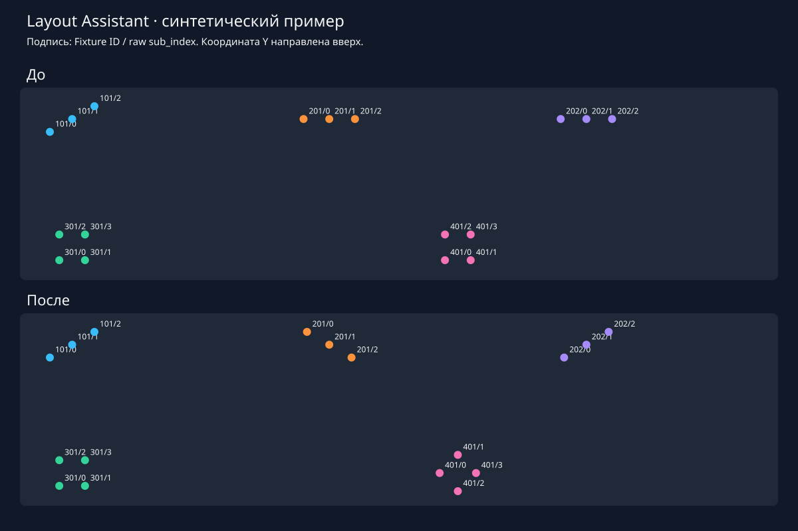

# Layout Assistant для grandMA2 3.9

Прототип 0.1.0 переносит взаимное расположение выбранных сабфикстур одного прибора на другие приборы в Layout. У каждой цели свои угол, отражение, центр и соответствие пикселей. Число пикселей и модель прибора в коде не зашиты.

**Статус:** математическое ядро, обработка XML и адаптер проверены на Lua 5.3.6; на настоящей grandMA2/onPC прототип ещё не испытан. [Исследование API и границы достоверности](docs/API_RESEARCH_RU.md) и [протокол испытания](docs/TESTING_RU.md) входят в проект.

## Что умеет

- Копирует относительные координаты выбранного набора пикселей; сохраняет центр каждого целевого набора или использует заданный центр.
- Переносит шаблон, например, с угла `+30°` на `−30°`. Отражение и перестановка индексов задаются независимо.
- Работает с линейками, матрицами, несколькими рядами, асимметричными наборами. Для нескольких типов можно задать несколько шаблонов в одном offline-рецепте.
- Сначала показывает полный список старых/новых координат, сохраняет новый XML и TXT. Исходный XML не перезаписывается.
- В консоли создаёт **копию всего Layout в свободном слоте** после ввода `CREATE <номер>`. Существующий слот назначения отклоняется. Редактирование исходного Layout не реализовано.
- Сохраняет остальные байты XML: размеры элементов, изображения, подписи, фон, посторонние приборы и их позиции. После импорта проверяет координаты целей повторным экспортом.

Поворот группы здесь означает поворот **координат центров пикселей**. Изображения/иконки и прямоугольники отдельных пикселей не поворачиваются. Патч, Stage, DMX, группы Pool и Programmer не редактируются.

## Быстрая проверка без консоли

Нужны Python 3.9+ и Lua **5.3**. Команды выполняются из корня проекта:

```sh
python3 tools/build.py
python3 tools/check.py
mkdir -p out
lua5.3 tools/offline.lua examples/synthetic-layout.xml examples/recipe.lua out/result.xml
python3 tools/preview.py examples/synthetic-layout.xml out/result.xml out/preview.svg
```

Если Lua называется иначе: `LUA=/полный/путь/lua python3 tools/check.py`. В Windows можно задать переменную `LUA` средствами используемой оболочки. Команда offline тоже работает с `lua`, если это Lua 5.3.

В `out/` появятся результат, текстовый план и SVG «до/после». Повторный запуск с тем же именем файла завершится отказом от перезаписи. `examples/synthetic-layout.xml` — **искусственные тестовые данные**, а не проверенный экспорт из onPC. Не импортируйте их в своё рабочее шоу.



## Установка на grandMA2/onPC

1. Сначала используйте отдельное тестовое шоу в grandMA2 **3.9** и прочитайте [протокол проверки](docs/TESTING_RU.md).
2. Скопируйте **оба** файла из `dist/` в `gma2/plugins` на USB или в каталог `plugins` своей установки onPC. Сохраняйте имена: XML ссылается на `layout_assistant.lua` через `luafile`.
3. Откройте Plugin Pool, редактор **пустого** слота → Import → `layout_assistant.xml`. Оставьте Execute on Load выключенным. Запустите плагин вручную.
4. Первый режим по умолчанию — `probe`. Он только перечисляет доступные свойства Layout и, по желанию, Fixture в Command Line Feedback. Команды записи не выполняются.

Такой порядок установки описан в официальном [Edit Plugins, версия 3.9](https://help.malighting.com/grandMA2/en/help/key_plugins_edit.html). Вместо импорта можно вставить собранный Lua в редактор пустого Plugin вручную.

## Работа в консоли

Все нужные пиксели источника и целей должны **уже присутствовать в одном исходном Layout**. Располагать цели заранее аккуратно не обязательно: по умолчанию сохраняется среднее арифметическое их выбранных центров. Приборы должны быть пропатчены. Автоматического определения совместимости FixtureType нет: оператор выбирает аналогичные пиксельные секции.

Интерфейс плагина использует короткие английские строки; инструкция и документация — на русском.

1. Выберите `preview`, укажите исходный Layout и абсолютный путь к **существующему** каталогу `importexport`. Плагин не меняет выбранный диск. Примеры: `C:/ProgramData/MA Lighting Technologies/grandma/gma2_V_ВАША_ВЕРСИЯ/importexport` или `/data/ma/actual/gma2/importexport`. Фактический каталог проверьте на своей станции.
2. Плагин экспортирует снимок с новым именем. Укажите Fixture ID шаблона. В Feedback появятся доступные **сырые XML `sub_index`**.
3. Выберите только нужные пиксели: список через запятую. `root` означает ссылку без `sub_index`. Не включайте мастер-модуль прибора, если он не является частью геометрии. **Не приравнивайте raw-индекс к отображаемому `Fixture N.M` без проверки:** см. [исследование](docs/API_RESEARCH_RU.md).
4. Укажите текущий угол шаблона в Layout. Ноль — локальная ось X вправо; положительный угол — против часовой стрелки при Y вверх. Угол задаётся оператором, а не считывается из Stage/RotZ.
5. Введите ID целей через запятую. Для каждой цели задайте список raw-индексов **в порядке соответствующих пикселей шаблона**, конечный абсолютный угол, `none`/`flip_x`/`flip_y` и `centroid` либо `x,y`.
6. Просмотрите Feedback и сохранённый TXT. В режиме `preview` импорта нет.
7. Чтобы получить Layout в шоу, повторите мастер в режиме `create`, укажите свободный слот, изучите свежий план и введите **точно** `CREATE 99` для слота 99. Пустой ответ или Esc отменяет импорт. Штатные диалоги MA2 не подавляются.

До импорта плагин заново экспортирует исходный Layout и сравнивает содержимое Group со снимком. Также повторно проверяются свободный слот и файл результата. После импорта повторный экспорт проверяет координаты с допуском `0.0011` единицы Layout. Если проверка не прошла, результат остаётся для ручной диагностики; повторного импорта или автоматического удаления нет.

Макрос запуска необязателен: вручную создайте его в свободном Macro Pool и добавьте одну строку `Plugin 101`, заменив 101 **фактическим номером установленного плагина**. Плагин сам макросы не создаёт и существующие макросы не меняет.

## Углы справа и слева

Пусть шаблон расположен под `+30°`. Для такого же прибора слева под `−30°` задайте:

```lua
source  = {fix_id=101, indices={'0','1','2'}, angle=30}
target  = {fix_id=201, angle=-30, mirror='none'}
```

Цели получат относительные позиции с поворотом на `−60°` относительно шаблона. Нумерация пикселей сохранится. Если физическая нумерация на другой стороне обратная, задайте, например, `indices={'2','1','0'}`. Если требуется геометрическое отражение асимметричной формы, используйте `flip_x` или `flip_y`. Это отдельные решения; «лево» по номеру прибора не определяется.

`flip_x` меняет знак локальной X до конечного поворота; `flip_y` — знак локальной Y. Два отражения эквивалентны дополнительному повороту на 180°, поэтому отдельного режима для них нет.

## Несколько типов и собственные рецепты

[examples/recipe.lua](examples/recipe.lua) показывает два независимых шаблона: линейку из трёх пикселей и матрицу 2×2. В `jobs` можно добавить другие типы без изменения исходников. Каждый источник должен иметь собственную корректно подготовленную геометрию.

У `source` обязательны `fix_id`, непустой `indices`, `angle`. У каждой цели обязательны `fix_id`, `angle`; необязательны `indices` (по умолчанию список источника), `mirror` (по умолчанию `none`), `x,y` (по умолчанию центр выбранных элементов). У источника в offline-рецепте тоже можно задать `x,y` для нестандартной точки вращения. Оба значения центра задаются вместе.

Список цели сопоставляется списку источника по порядку. Количество должно совпадать; индексы не обязаны быть последовательными. Незадействованные модули остаются на месте. Один целевой элемент нельзя записать дважды; прибор-шаблон нельзя одновременно использовать как цель. Все задания читают один исходный снимок.

Рецепт — исполняемый Lua-файл: запускайте только собственные доверенные конфигурации. Сам XML не исполняется.

## Ограничения прототипа

- Полная доступность свойств элементов Layout через Lua на конкретной сборке 3.9 не установлена. XML — выбранный проверяемый путь; отсутствие свойства в диагностике не доказывает невозможность доступа.
- Поддержан конкретный формат одного экспортированного Layout: `MA / Group / LayoutData / SubFixtures / LayoutSubFix / Subfixture` с `fix_id`, `sub_index`, `center_x`, `center_y`. Другая структура, версия, неоднозначные дубликаты, DTD или CDATA приводят к остановке. Это ограниченный XML-reader, не полноценный XML/XSD-валидатор.
- Каналы и удалённые ссылки сохраняются, но не используются как шаблоны/цели. Создание недостающих элементов, перенос между разными Layout и редактирование существующего слота не реализованы.
- Равное число пикселей не доказывает одинаковый тип или физический порядок. Автоопределения FixtureType, DMX-режима, зеркальности, выбора Pool Group и порядка текущей Selection нет.
- Произвольный поворот прямоугольника/иконки отдельного элемента не обещается. Меняются только центры, без масштаба и привязки к Snap.
- Файлы ограничены 16 MiB, глубина XML — 64. Позиции/углы ограничены конечными числами с модулем не более 1 000 000. Сохраняются шесть знаков после запятой; точность импорта уточняется на onPC.
- Проверка свободного слота и запись файла не являются атомарной транзакцией. Первый тест выполняйте без одновременных правок другими станциями; окончательная защита при конфликте — оставленные включёнными диалоги MA2. Нет автоматического rollback и обещания работоспособности Oops.
- Исходные файлы и снимки остаются локально. Плагин не содержит сетевого кода; удаление временных файлов выполняет оператор.

## Структура проекта

| Путь | Назначение |
| --- | --- |
| `dist/` | Собранный плагин, Lua + XML для установки |
| `src/core.lua` | Модель, геометрия, проверка соответствий, план |
| `src/xml.lua` | Чтение XML и замена только диапазонов значений координат |
| `src/ma2.lua` | Диагностика, файлы, экспорт, подтверждение, импорт, проверка |
| `src/ui.lua` | Мастер ввода |
| `tools/` | Сборка, offline-расчёт, SVG и проверка выпуска |
| `tests/` | 30 автоматических тестов без консоли |
| `docs/` | Исследование, ручное испытание и результаты проверки |

Исходники распространяются по [MIT License](LICENSE). Это независимый прототип, не продукт MA Lighting.
